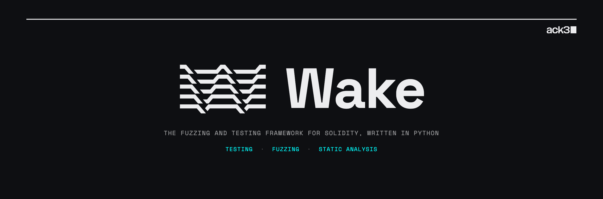

# Wake

Before a smart contract ships, someone tries to break it. Wake is the Python framework ack3's auditors break them with: tests, fuzz harnesses and static analysis in ordinary Python, executed by an EVM embedded in the Python process. Wake 5 changes who writes the harness: an agent drafts it, a person checks it, Wake runs it at native speed.

[](https://pypi.org/project/eth-wake/)
[](https://pypi.org/project/eth-wake/)
[](LICENSE)
[](https://ack3.ai/wake/docs/latest/)

Developed by [ack3](https://ack3.ai). Created at Ackee Blockchain in 2022. Open source under the [ISC license](LICENSE).

## Install

Python 3.10 or newer; prebuilt wheels for Linux (x86_64, aarch64, i686; glibc and musl), macOS 14+ (Apple Silicon and Intel) and Windows (x64 and ARM64), CPython 3.10 to 3.15.

```shell
pip3 install eth-wake
```

With [uv](https://docs.astral.sh/uv/): `uv tool install eth-wake`.

Wake downloads the Solidity compiler versions a project needs on first use (on Apple Silicon, `solc` runs through Rosetta 2: `softwareupdate --install-rosetta`). No node software is required: the in-process EVM is the default engine. Anvil or Hardhat are needed only to opt back into a JSON-RPC chain.

## Start fuzzing

```shell
wake up --example counter          # example project in an empty directory, or `wake up` in an existing one
wake test                          # run the tests (pytest underneath)
wake test --cov 1 tests/test_x.py  # the same, writing statement coverage to wake-coverage.cov
wake test tests/test_x.py --seed <hex>   # reproduce a failing sequence
```

`wake up` writes `wake.toml`, compiles the project and generates `pytypes`: Python types for every contract, so tests get autocompletion and type checking against the Solidity code. The engine is `[testing] cmd = "revm"`; projects created with older versions may still pin `anvil` there.

A fuzz test in Wake is **manually guided**: the auditor writes the moves (`@flow`, one transaction each) and the rule that must hold (`@invariant`), and keeps a Python model of what the contract state should be. Wake chooses the order and the values, checks the invariants after every flow, and when a sequence fails, shrinks it to the transactions that matter.

```python
from wake.testing import *
from wake.testing.fuzzing import *
from pytypes.contracts.Counter import Counter


class CounterTest(FuzzTest):
    def pre_sequence(self) -> None:
        self.owner = random_account()
        self.counter = Counter.deploy(from_=self.owner)
        self.count = 0                      # the model

    @flow()
    def flow_increment(self) -> None:
        self.counter.increment(from_=random_account())
        self.count += 1

    @flow()
    def flow_decrement(self) -> None:
        with may_revert(Panic(PanicCodeEnum.UNDERFLOW_OVERFLOW)) as e:
            self.counter.decrement(from_=random_account())
        if e.value is not None:
            assert self.count == 0          # the revert was expected
            return "underflow"              # revert paths get their own line in the summary
        self.count -= 1

    @invariant(period=10)
    def invariant_count(self) -> None:
        assert self.counter.count() == self.count


@chain.connect()
def test_counter_fuzz():
    CounterTest().run(sequences_count=10, flows_count=100)
```

The [getting started guide](https://ack3.ai/wake/docs/latest/testing-framework/getting-started/) walks through the example project step by step; the [fuzzing docs](https://ack3.ai/wake/docs/latest/testing-framework/fuzzing/) cover flows, invariants, preconditions, weights and the shrinker.

## Fuzz with an agent

Harnesses are plain Python an agent can read, run and revise, and every revision executes in-process at native speed. The person stays on the three things that decide whether a harness is any good: what it asserts, which values it asserts against, and which branches actually ran ([Vibe Fuzzing Guide](https://ack3.ai/research/vibe-fuzzing-guide-for-wakes-manually-guided-fuzzing/)).

Paste this into Claude Code, Codex or Cursor in a project where `wake up` has run, with the contract path filled in. It was tested cold on the example project.

```text
Fuzz the contract at <path/Name.sol> with Wake. Run `wake up`; make sure wake.toml has `[testing] cmd = "revm"`. Write tests/test_<name>_fuzz.py with `from wake.testing import *`, `from wake.testing.fuzzing import *`, `from pytypes.<path>.<Name> import <Name>` and `logger = logging.getLogger(__name__)`. Define a FuzzTest subclass that deploys the contract in pre_sequence and keeps a Python model of its state. Write one @flow per state-changing function, each sending exactly one transaction, with the expected result computed from the model before the transaction. Wrap the call in `with may_revert() as e:`, assert that e.value equals the exact error (`<Name>.SomeError(args)`, `Error("message")` or `Panic(PanicCodeEnum.X)`), and return a short string on every revert path. Assert every field of every event in `list(tx.events)`. Add @invariant methods that compare the model to the contract's view functions, including one that is not the contract's own arithmetic restated. Run `wake test --cov 1 tests/test_<name>_fuzz.py` and report the flow counts from the summary and the uncovered statements from wake-coverage.cov. Do not change any Solidity source.
```

`wake mcp` gives the agent the same static facts the language server has (contracts, functions, definitions and references, inheritance order, storage layout, state changes, selectors, external calls), as compact text. Register it once:

```shell
claude mcp add wake -- wake mcp
```

```json
{ "mcpServers": { "wake": { "command": "wake", "args": ["mcp"], "cwd": "/path/to/project" } } }
```

## What Wake does

- **Testing framework** on top of [pytest](https://docs.pytest.org), with generated `pytypes`, call traces, console logs, coverage and a debugger. [Docs](https://ack3.ai/wake/docs/latest/testing-framework/overview/)
- **Manually guided fuzzing**: flows and invariants in Python, random sequencing by the engine, a two-phase shrinker. [Docs](https://ack3.ai/wake/docs/latest/testing-framework/fuzzing/)
- **In-process EVM** ([revm](https://github.com/bluealloy/revm)): no development node, forking of live chains through `chain.connect(fork=...)`, several chains in one process for cross-chain tests. [Migration from Wake 4](https://ack3.ai/wake/docs/latest/testing-framework/migrating-from-wake-4/)
- **Detectors** (`wake detect`, SARIF export) and **printers** (`wake print`: control-flow graphs, inheritance, storage layouts, selectors). Both are plugin APIs for project-specific rules. [Detectors](https://ack3.ai/wake/docs/latest/static-analysis/using-detectors/) · [Printers](https://ack3.ai/wake/docs/latest/static-analysis/using-printers/) · [Writing new ones](https://ack3.ai/wake/docs/latest/static-analysis/getting-started/)
- **MCP server** (`wake mcp`) for agents. [Docs](https://ack3.ai/wake/docs/latest/mcp/using-mcp/)
- **Language server** (`wake lsp`) and the [Solidity (Wake)](https://marketplace.visualstudio.com/items?itemName=AckeeBlockchain.tools-for-solidity) VS Code extension: diagnostics, references, graphs and detections in the editor. [Docs](https://ack3.ai/wake/docs/latest/language-server/)
- **Deployment scripts and mainnet interaction** with the same `pytypes` the tests use. [Docs](https://ack3.ai/wake/docs/latest/testing-framework/deployment/)
- **Solc version manager** (`wake svm`), Solidity through 0.8.38, GitHub Actions for [setting up Wake](https://github.com/marketplace/actions/wake-setup) and [running detectors](https://github.com/marketplace/actions/wake-detect).

## What changed in Wake 5

- The default engine is the in-process EVM. On the Daedaluzz maze benchmark Wake 5 executes 29,931 transactions per second, on par with Foundry (30,186) and 11.5× Echidna (2,600). The same measurement shows that on constant-guarded code the input generator, not the engine, bounds what random fuzzing finds in eight hours: 75 of 153 assertions, where an agent-written harness reached all 153 in 33 to 79 minutes. Both results are in the [preprint](#research).
- Chain history is bounded to the newest 256 blocks by default, which keeps multi-hour campaigns memory-stable; keep references to transaction objects needed later, or raise `testing.block_history`.
- `wake mcp` is new.
- `pytypes` generated by Wake 4 must be regenerated. The [migration guide](https://ack3.ai/wake/docs/latest/testing-framework/migrating-from-wake-4/) lists every breaking change.

## Research

- **Wake 5: A Python Framework for Solidity Testing, Fuzzing, and Static Analysis** (Gattermayer, Převrátil, 2026). arXiv preprint: [arXiv:2611.09307](https://arxiv.org/abs/2611.09307). Framework design, a three-fuzzer benchmark over 75 eight-hour campaigns, the generator-prior analysis, five agent-written harness campaigns, and a static-analysis ablation in an agentic review. Benchmark fork and campaign data: [daedaluzz-benchmark](https://github.com/ack3-ai/daedaluzz-benchmark).
- [Benchmarking EVM fuzzers against an agent-written harness](https://ack3.ai/research/benchmarking-evm-fuzzers-against-an-agent-written-harness/) and [Static analysis MCP tools in an AI audit benchmark](https://ack3.ai/research/ablating-static-analysis-from-an-ai-security-benchmark/), the research notes the preprint grew from.
- [Introducing manually guided fuzzing](https://ack3.ai/research/introducing-manually-guided-fuzzing-a-new-approach-in-smart-contract-testing/) and the [research journal's Wake articles](https://ack3.ai/research/tags/wake/).

```bibtex
@misc{gattermayer2026wake5,
  title         = {Wake 5: A Python Framework for Solidity Testing, Fuzzing, and Static Analysis},
  author        = {Gattermayer, Josef and P{\v{r}}evr{\'a}til, Michal},
  year          = {2026},
  eprint        = {2611.09307},
  archivePrefix = {arXiv},
  primaryClass  = {cs.SE},
  url           = {https://arxiv.org/abs/2611.09307}
}
```

## Documentation and community

- [Documentation](https://ack3.ai/wake/docs/latest/) · [Changelog](https://ack3.ai/wake/docs/latest/changelog/) · [Contributing](https://ack3.ai/wake/docs/latest/contributing/)
- [Awesome Wake tests](https://github.com/Ackee-Blockchain/awesome-wake-tests): fuzz tests and unit tests from real audits
- Questions and bugs: [GitHub issues](https://github.com/ack3-ai/wake/issues). Security reports: see [SECURITY.md](SECURITY.md)
- Updates: [x.com/ack3ai](https://x.com/ack3ai)

## Support the project

Wake is on [Giveth](https://giveth.io/project/wake:-solidity-static-analysis-and-fuzzing-framework).

## License

[ISC](LICENSE).
